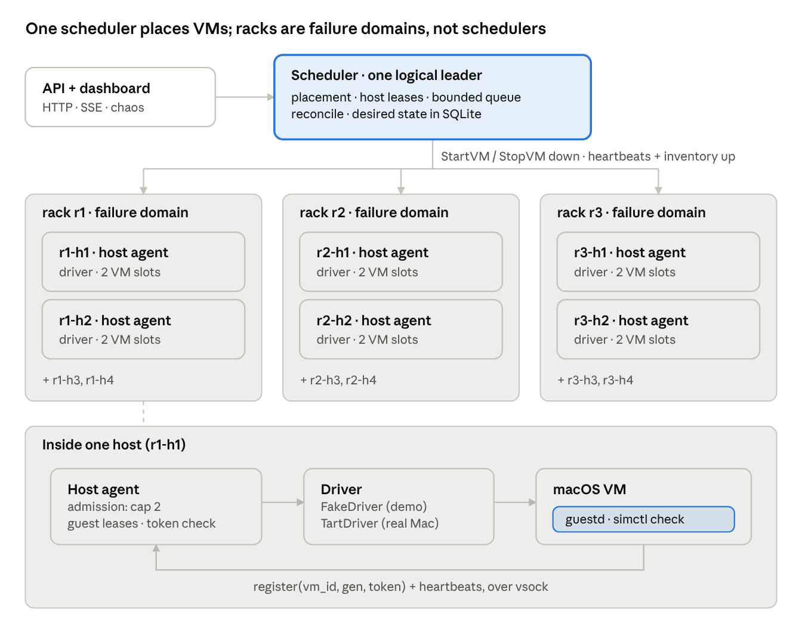
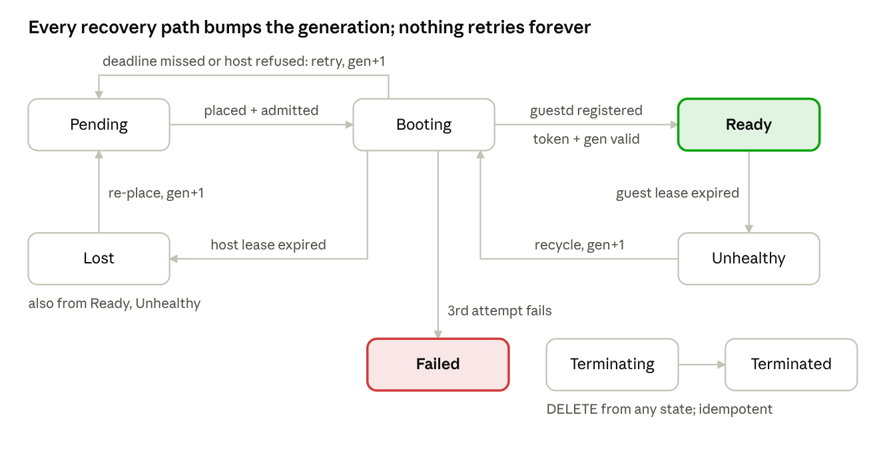

# macOS VM Control Plane — Take-Home Build Plan

Nov 11, 2026 · @Hamish Bultitude

## Goal and pitch

Build, in about 4 hours, a control plane that places macOS VMs across a fleet of Macs grouped into racks. Every VM runs a small guestd that proves it is ready. The system has to stay correct when guests, hosts, racks or the scheduler itself fail. The hypervisor is behind a driver interface, so the whole thing runs as a simulation of 12 hosts in one Go binary, deployed on Railway with a live dashboard the interviewer can break on purpose.

**Why it matters:** agents that build and test iOS apps need macOS, and macOS only runs on Apple hardware. That means a fleet of Macs with hard limits: 2 macOS VMs per host under Apple's licence, and 30 to 60 s boots. A control plane that hands an agent a VM it can trust is ready, and never two copies of the same VM, is the foundation for that.

**How it maps to Theme 3:**

- **Failure:** VM states are explicit, boots have deadlines, guests and hosts hold heartbeat leases, and generation numbers fence off stale VMs after a partition. A restarted scheduler reconciles its state.
- **Concurrency:** each component runs single-owner event loops. Placement is optimistic and the host agent has the final say on admission. Create requests are idempotent.
- **Scale and stress:** racks act as failure domains, VMs are spread across them, and requests sit in a bounded queue. When it's full the API returns 429, so the system degrades predictably instead of falling over.

The thesis to say out loud: *the hypervisor is a plug-in; the product is lifecycle correctness under failure.*

## Architecture

There is one logical scheduler with a flat view of every host. Racks are labels used for failure domains, not a layer of schedulers. Each Mac runs a host agent that owns one driver and has the final say on its own capacity. guestd talks only to its own host agent, never directly to the scheduler.



The scheduler only ever talks to host agents. Each guest reports to its own agent, so the scheduler handles one heartbeat per host, not one per VM.

**Components**

| Component | Owns | Talks to | In the demo |
| --- | --- | --- | --- |
| Scheduler | Desired state, placement, host leases, the API | Host agents | One goroutine event loop, with state in SQLite |
| Host agent (one per Mac) | Local admission (cap 2), the driver, guest leases | Scheduler (up), guestd (down) | 12 instances in-process, 4 per rack across 3 racks |
| Driver | Create, start, stop and list VMs on one host | The hypervisor | `FakeDriver` (simulated); `TartDriver` written but not deployed |
| guestd | Readiness checks, heartbeats | Its host agent (vsock in real life) | The same `guest` package the real binary uses, run in a goroutine |
| simnet | The transport between scheduler and agents | Everything | In-memory, with injectable latency, drops and rack partitions |

**Why guestd talks to the host agent, not the scheduler:** the guest never needs a network route to the control plane. Real Macs would use virtio-vsock, which needs no IP. The host agent checks the boot token locally and sends the scheduler one combined heartbeat for the whole host. That keeps fan-in at the scheduler at O(hosts), not O(VMs).

**Why the tree isn't hierarchical:** Borg, Kubernetes and Nomad all use one logical scheduler per cell, replicated for HA, and treat rack, power and ToR switch as constraints for spreading VMs. Hierarchy shows up at the cell or region level, around 10k machines in Borg's case, as a thin router that sends a request to a cell. A Mac fleet in the hundreds to low thousands, making about 2 placements per host per boot cycle, is far below one scheduler's limit. The one real "local scheduler" is admission: the scheduler places optimistically, as in the Omega paper, and the host agent can refuse. The README shows this future shape:

```
Global router (future: picks a cell / region)
└── Cell scheduler (one leader, replicated)   ← built
    ├── rack r1  (failure-domain label)
    │   ├── host r1-h1: agent + driver (cap 2)
    │   └── … r1-h4
    ├── rack r2 …
    └── rack r3 …
```

**Railway does not compromise this:** everything above runs in one container. Every component boundary is a Go interface: Driver, Transport and Clock. The in-process sim uses the fake implementations and production would swap in real ones. Splitting the binary into `--role=scheduler` and `--role=agent` with an HTTP transport is a stretch goal, and it changes no logic.

## Runtime: one live process, real goroutines

Everything runs as real goroutines on a real clock, sped up for the demo, in one process. There is no separate simulator and no rewind. That keeps one codebase and one mental model, and puts real concurrency at the centre of the demo.

**How it's built**

- **Each component instance is an actor.** The scheduler, every host agent and every guestd is one goroutine that owns its state and handles one message at a time from its inbox channel. Components share no state and need no locks inside them.
- **The logic lives in a plain method, `handle(now, msg) → []out`,** separate from the goroutine loop. Unit tests call it directly with a fake time, so the logic stays easy to test even though the running system isn't deterministic.
- **Slow work never runs inside `handle`.** A driver call is the slow part: a VM boot takes 30 to 60 s on real hardware, and the FakeDriver sleeps to imitate that. It runs in a worker goroutine and posts a "done" message back to the inbox. Otherwise a slow boot would stop the agent's heartbeats, and the scheduler would wrongly declare the host dead.
- **simnet** is an in-memory transport between actors that can inject delays, drops, duplicates and rack partitions, all in real time.
- **HTTP handlers and the SSE hub only talk to the scheduler by sending it messages and reading the snapshots it publishes.**

**Time comes from a clock you can speed up and pause**

- Every component reads the time and creates timers through a `Clock` interface. Nothing calls `time.Now()` or `time.After` directly.
- The demo clock runs at a speed multiplier of 1×, 2×, 5× or 10×, and it can pause: timers stop and deadlines freeze. That gives the dashboard pause and fast-forward without a simulator.
- Real-world timings (30 to 60 s boots, 10 to 30 s leases) are shortened by a config setting, and the README documents both sets of values.

**Storage:** the demo uses SQLite directly too. Killing and restarting the scheduler reads the real database, which shows the save-before-you-act rule working for real. "Wipe store" deletes the file. Tests use an in-memory SQLite database.

**What dropping the simulator costs, stated in the README:**

- No rewind or scrubbing.
- Runs can't be reproduced exactly. Chaos decisions come from a seeded random number generator, but goroutine timing varies, so the same seed won't replay identically.
- Invariants can't be checked at one perfectly consistent moment (see the invariant checker).
- A deterministic simulator, in the style of FoundationDB and TigerBeetle, becomes the top "what's next" item. Because the logic sits in `handle(now, msg)`, adding one later wouldn't mean rewriting the components.

**Concurrency tests** (W2, about 25 minutes, part of the 2:00 gate, all under `-race`). They run 1 scheduler and 6 agents in one process, with the clock at high speed:

- `TestKillGuestd`: the VM is recycled and becomes Ready again.
- `TestKillHost`: its VMs are re-placed at gen+1, and the stale copy is stopped when the host comes back.
- `TestDuplicateStartVM`: exactly one VM runs, and no slot leaks.
- `TestSlowBootKeepsHeartbeats`: during a 2 s boot, no gap between heartbeats exceeds the heartbeat interval plus 50 ms.
- `TestDeleteDuringBoot`: the VM ends Terminated, never Ready, and its slot is freed.
- **Every test checks two more things:** zero invariant violations, and the goroutine count back at its starting level after shutdown.

## Core mechanisms

Six mechanisms carry the whole reliability story. Build them in this order, because each one depends on the one before.

### 1. VM state machine

The scheduler owns each VM record, and every state change goes through one `Transition(from, to, reason)` function. That function rejects illegal moves and appends to the event log. Each transition is persisted before it takes effect.



Only a guestd presenting the current token and generation can move a VM to Ready. Every way out of trouble re-boots at generation+1, and the retry budget ends in Failed.

### 2. Three different IDs, three different jobs

| Mechanism | Question it answers | Who issues it | Checked by |
| --- | --- | --- | --- |
| Idempotency key | "Did I already accept this create?" | The client, on `POST /v1/vms` | Scheduler: the same key returns the same VM |
| Boot token | "Is this really the guestd I launched?" | The scheduler, fresh for every boot | Host agent, when guestd registers |
| Generation | "Is this message from the current incarnation?" | The scheduler, +1 on every (re)placement | Scheduler and agent: anything with a lower generation is rejected |

Generation is a **fencing token**. When a partitioned host comes back still running `vm-42` at generation 3, and generation 4 is already running elsewhere, the scheduler rejects the stale heartbeat and tells that host to stop gen 3. The README should spell this out, because it's the subtlest guarantee in the system.

### 3. Leases at two levels

- **Guest lease** (guestd → agent): heartbeat every 2 s, 6 s TTL. If it expires, the VM goes `Unhealthy`, then gets recycled.
- **Host lease** (agent → scheduler): heartbeat every 2 s carrying the host's full VM inventory, 6 s TTL. If it expires the host becomes `Suspect`, and after another 6 s grace period it becomes `Lost`. Its VMs then go `Lost` and are rescheduled at generation+1.
- These are sim time values. Speed the clock up so a demo cycle takes seconds, and note the real-world values in the README: 10 to 30 s TTLs and 30 to 60 s boots.

### 4. Deadlines and bounded retries

Each VM has a boot deadline (sim: 15 s). If it passes, the VM is stopped, its attempt counter goes up, and it's re-placed on a different host if one is available. The retry waits for exponential backoff with jitter. After 3 attempts the VM goes to `Failed` with the reason recorded. No loop is unbounded.

### 5. Placement and admission

1. **Filter:** keep hosts whose lease is healthy, that aren't cordoned or draining, and that have a free slot as far as the scheduler can see.
2. **Score:** prefer the rack with the fewest VMs from this pool (spreading), then the least-loaded host. A **pool** is a named group of interchangeable VMs with the same image and size, such as `ios-xcode16-m`. Spreading per pool means a dead rack takes out about a third of a pool, not all of it. The demo ships with 2 pools so the spreading is visible.
3. **Reserve optimistically:** mark the slot `Reserved` in the scheduler's in-memory view, with a 10 s reservation TTL, and send `StartVM(id, gen, token)`. The scheduler is a single event loop, so two requests never race for one slot inside it. The optimism is about the scheduler's view of a host possibly being stale compared with the host itself.
4. **The agent admits or refuses.** It is the authority on its own capacity (cap 2). A refusal, or the reservation TTL expiring, releases the reservation and goes back to step 1, excluding that host.
5. **Nothing fits:** the request goes into the bounded priority queue (5b). When the queue is full and the request can't displace a lower-priority one, the API returns `429` with `Retry-After`.

**Slot lifecycle on each host:** `Free → Reserved → Occupied → Releasing → Free`. Releasing means the VM is being stopped and its disk clone deleted, and it still counts as used. A slot is only handed out again once the host reports it clean. Freeing a slot like this is usually called *release* or *reclaim*.

### 5b. Priority admission queue

Requests that can't be placed wait in a bounded queue of 32, ordered by priority class, with aging so that low priority can't starve. This queue is where the system degrades predictably: under overload, batch work is shed first and interactive agents keep getting VMs.

- **Classes:** `0 replacement` (reserved), then `1 interactive` (an agent waiting live), `2 standard` and `3 batch`, which are set per request on `POST /v1/vms`. Within a class, requests are served first in, first out.
- **Replacement is a class of its own.** A VM that was Ready and was lost through no fault of its own goes back in at class 0, ahead of everything else. Examples are its host dying, its rack being partitioned, or the operator draining its host. It was admitted work with an agent mid-task, so the capacity was already promised to it. Replacements are never shed.
- **Guardrail 1: only losses the VM didn't cause qualify.** A VM that never reached Ready, or that failed on its own (a boot hang, guestd crashing during boot), comes back as a `retry` at its requested class with backoff and the 3-attempt budget. Otherwise a crash-looping VM would sit at the front of the queue and keep taking capacity. A guestd crash on a Ready VM is recycled in place on the same host and never touches the queue.
- **Guardrail 2: class 0 can't be reached any other way.** Aging stops at class 1, so batch work can climb to interactive but never to replacement. An admin can't move a request into class 0 either. Database triggers enforce both.
- **Aging:** effective class = `max(1, class − wait / 60 s)` in sim time, for every request that isn't a replacement. I tested 30 s and it was too aggressive: everything that had waited a minute tied with interactive requests.
- **Retries keep their place.** A retried request keeps its original `enqueued_at`, but isn't eligible until `not_before`, which is when its backoff ends.
- **No head-of-line blocking:** dequeue looks at the first 8 eligible entries and places the first one that fits.
- **Shedding when full:** a new request that outranks the worst queued entry (lowest effective class, newest, never a replacement) displaces it. That entry goes to `Failed` with reason `shed`. Otherwise the new request gets `429` with `Retry-After`.
- **Leave headroom for a rack failure.** With 3 racks, losing one removes a third of the capacity. If the fleet runs above roughly 66% busy, the replacements can't all fit, and they'll hold the front of the queue while new interactive requests get 429s. That's the correct priority order, but the real fix is spare capacity. The dashboard shows "rack-loss headroom", and the README discusses keeping N+1 racks.
- **Moving requests around:** `POST /v1/queue/{vm_id}/priority` moves a queued request between classes 1 and 3. Its requested class on `vms` stays as it was.
- **No preemption of running VMs.** macOS VMs can't be live-migrated, and killing an agent's session costs more than waiting.
- **In memory, the queue is just a slice scanned in full on every dequeue,** which is O(n) for n ≤ 32. A heap buys nothing at this size, and aging changes the ordering over time, which a heap handles badly.

### 6. Reconciliation

The scheduler persists desired state (the VM specs and their target state). Hosts are the source of truth for what is actually running. Whenever a host (re)registers, and whenever the scheduler restarts, the scheduler compares that host's reported inventory with its own records, and for each VM:

- **Desired and running at the current generation:** adopt it.
- **Running but stale, or unknown to the scheduler:** tell the host to stop it.
- **Desired but missing:** re-place it at generation+1.

**Generation invariant:** only the scheduler issues generations, and it persists the new generation *before* sending `StartVM` (persist, then act). Hosts never increase a generation themselves. During a scheduler outage, an Unhealthy VM stays Unhealthy until the scheduler is back. As a result a host can never report a generation higher than the stored one, so reconciliation only sees two cases: equal (adopt) or lower (stop). If a host does report a higher generation, the store must have been lost. The scheduler then raises an alert, adopts the VM, and moves its generation counter past the highest it has seen.

While the scheduler is down, running VMs carry on, because agents keep their guest leases locally. New creates get `503` until the scheduler is back.

## Failure scenarios and chaos demos

Each row is a button on the dashboard, a scenario test in `internal/sim/scenarios_test.go`, and a row in the README. Build them in the order shown. The first four are must-haves.

| # | Scenario | How it's injected | How it's detected | What the system does | Guarantee |
| --- | --- | --- | --- | --- | --- |
| 1 | guestd dies | Kill guestd | Guest lease expires (agent) | Unhealthy → recycle on the same host → Ready | Work is never routed to a VM that isn't ready |
| 2 | Boot hangs | FakeDriver hang probability, or the "hang next boot" button | Boot deadline passes | Stop, back off, re-place on another host; Failed after 3 attempts | Bounded time and bounded attempts |
| 3 | Host dies | Kill host | Host lease expires (scheduler) | Suspect → Lost → its VMs re-placed at gen+1, spread across racks | No VM is lost for good |
| 4 | Overload | Flood: 60 creates against 24 slots | Free slots and queue depth | 24 run, 32 queue in priority order. When the queue is full, a higher-priority request displaces the worst queued one; otherwise 429 + Retry-After. Interactive requests still get placed while batch is shed | Latency and memory stay bounded |
| 5 | Rack partition, then heal | Partition r2 → heal | All 4 host leases in r2 expire | VMs re-placed onto r1 and r3. On heal, stale gen-N copies are fenced and stopped | Never two authoritative copies: the stale one is fenced, then stopped when the partition heals |
| 6 | Scheduler crash | Kill scheduler → restart | Restart, then hosts re-register | Running VMs keep going; creates get 503; reconcile adopts, reaps or re-places | Data plane survives a control-plane outage |
| 7 | Duplicate create | Same idempotency key sent twice at once | Key lookup inside the single-owner loop | Second call returns the first VM | Exactly one VM per key |
| 8 | Impostor guest | Register with the right vm\_id but a wrong token | Token mismatch at the agent | Rejected and logged | Only the launched guest can mark a VM Ready |

**Background chaos:** the dashboard's intensity slider and fault filters drive a seeded random number generator that injects these faults continuously, so the fleet looks like a real one, not a perfect one. The seed is shown on screen. Goroutine timing varies, so runs aren't exactly reproducible. A fully deterministic simulator (as in FoundationDB and TigerBeetle) is listed under what's next.

## Chaos catalogue

There are 26 chaos modes across six layers, plus 6 presets that combine them. Every mode is available from the dashboard menus and from `POST /v1/chaos/{action}`, can be selected in the ambient-chaos filters, and is used by at least one automated scenario. The "expected" column is what the scenario asserts.

| Layer | Mode | Target | What it stresses | Expected outcome |
| --- | --- | --- | --- | --- |
| Guest | Kill guestd | VM | Guest lease, recycle in place | Ready again on the same host after one boot, at gen+1 |
| Guest | Crash VM | VM | Driver reports the VM exited | Same as kill guestd |
| Guest | Hang next boot | VM | Boot deadline, retries | Re-placed on another host with backoff; Failed after 3 attempts |
| Guest | Slow boot ×N | VM or host | Deadline settings, no false failover | Boots that finish within the deadline succeed; heartbeats never stop |
| Guest | Compromise | VM | Isolation, rate limits, quarantine | Every attack blocked, neighbours' metrics unchanged, quarantined after 5 attempts |
| Host | Kill host | Host | Host lease, replacement class | Its VMs re-placed at gen+1, ahead of the rest of the queue |
| Host | Pause heartbeats (a gray failure) | Host | False positives, fencing | The host is declared Lost and its VMs re-placed; when heartbeats resume, the stale copies are stopped |
| Host | Restart host | Host | Rejoining with an out-of-date inventory | Stale generations stopped, current ones adopted |
| Host | Clock skew ±30 s | Host | Leases measured on the scheduler's clock | No effect on lease decisions |
| Host | Fill disk | Host | Admission refusals | No placements there; other hosts absorb the load |
| Host | Cordon / drain | Host or rack | Operator workflows | No new placements; a drain empties the host, then removes it |
| Network | Partition rack, then heal | Rack | Losing a whole failure domain; fencing on heal | Re-placed onto other racks; stale copies fenced, then stopped |
| Network | One-way partition | Host | Scheduler hears the host but the host can't hear the scheduler, or the reverse | Commands don't arrive, so reservations expire and the VM is retried elsewhere; never placed twice |
| Network | Latency spike | Link or global | Timeouts versus leases | No false Lost below the lease TTL; placement slows but doesn't fail |
| Network | Packet loss % | Link or global | Retries, idempotency | The fleet converges eventually |
| Network | Duplicate messages | Global | Idempotent commands | Exactly one VM per (vm, gen) |
| Network | Reorder messages | Global | Generation checks on late messages | A late StopVM never kills a newer generation |
| Control plane | Kill scheduler, then restart | Scheduler | Save-before-you-act, reconcile | VMs keep running; creates get 503; reconcile is clean |
| Control plane | Wipe store | Scheduler | The "higher generation" alert path | Alert raised, VMs adopted, generation counter moved past the highest seen |
| Control plane | Slow store (+200 ms per commit) | Scheduler | Backpressure | Queue grows and 429s rise, with no violations |
| Load | Flood N | API | Admission, shedding | Queue stays bounded; batch is shed first |
| Load | Sustained load % with a priority mix | API | The target under load | p99 time to Ready stays within the target |
| Load | Burst after a rack loss | API and rack | Replacement priority, headroom | Replacements placed first; new interactive requests get 429 if headroom is negative |
| Topology | Add rack or host | Fleet | Live registration | New capacity drains the queue |
| Topology | Remove rack (by draining) | Fleet | Graceful removal | No VM lost |
| Ambient | Intensity slider + filters | Everything | Background faults at random | Zero violations; target holds up to the stated intensity |

**Presets.** Each is one button on the dashboard and one automated scenario.

| Preset | What happens | What it proves |
| --- | --- | --- |
| Split brain | Partition r2, wait for re-placement, then heal | Fencing: one authoritative copy, and stale copies stopped on heal |
| Gray failure | Pause heartbeats on 3 hosts whose VMs are healthy | Failover is safe even when the "dead" hosts are alive |
| Thundering herd | Run at 85% utilization, power off a rack, flood interactive requests | Replacement priority, headroom, and graceful shedding |
| Rolling maintenance | Drain r1, r2 and r3 in turn under load | Zero VMs lost during planned maintenance |
| Hostile tenant | Compromise 3 VMs during a flood | Isolation holds under load |
| Bad day | 50% ambient chaos, a latency spike, and a scheduler restart mid-flood | Everything at once: zero violations, the target is degraded but bounded |

## Correctness evidence: invariants, idempotent commands, metrics

Three things turn "it seems to work" into evidence: an invariant checker that never stops running, commands that are safe to receive twice, and metrics measured against one stated target. All three show live on the dashboard and run in the Go tests.

### Invariant checker

It runs every 100 ms of demo time. Each component hands over a copy of its state through its inbox. Checks within one component are exact. Checks across components allow one heartbeat of slack, because the copies are taken at slightly different moments. Running everything in one process is what makes this near-global view possible. A real fleet never gets one, and the README says so. A violation emits an `invariant` event, turns a red counter on the dashboard, and calls `t.Fatal` in tests.

| # | Invariant | What it catches |
| --- | --- | --- |
| 1 | At most one copy of a VM is *authoritative*: current generation and Ready in the scheduler | Broken fencing, double placement |
| 2 | A copy with an old generation is stopped within 1 heartbeat of its host reconnecting | Stale copies surviving a partition |
| 3 | No host runs more VMs than it has slots, counting Releasing | Admission bugs, slot leaks |
| 4 | A VM's generation never decreases, including across scheduler restarts | Persist-then-act violations |
| 5 | Every transition in the event log is in the legal-move table | State machine bypassed |
| 6 | Queue ≤ 32, and a replacement is never shed | Unbounded growth, broken priority |
| 7 | Zero successful attacks from a malicious guest | Isolation failures (see Security) |
| 8 | A Pending VM is placed within 2 s of capacity being free | A queue that's stuck while capacity sits free |

**An honest correction about invariant 1:** during a partition, the old copy really does keep running until the partition heals. Fencing guarantees it can't *act* through the control plane: its heartbeats are rejected and it can never be Ready. It doesn't guarantee the copy has stopped. The alternative is for a host to kill its own VMs once it can't reach the scheduler (self-fencing). But a host can't tell a partition from a scheduler crash, so self-fencing would also kill every VM during a scheduler outage. That trade-off goes in the README, with an optional `--self-fence` flag to demo the other side. Any work an agent does in a stale copy should also be fenced where it lands, for example by pushing with a token tied to the generation.

**Soak test:** run for 10 minutes at 10× speed with chaos at 50%, under `-race`, and assert zero violations. Log the seed and every chaos action, so a failure can still be investigated even though it may not replay exactly. It uses the same checker as the dashboard.

### Commands are safe to receive twice

The pair (vm\_id, generation) is the idempotency key for every command, so agents need no request-ID cache.

- **`StartVM(vm, gen)`:** already running at that gen → acknowledge and do nothing. Running a lower gen → stop it, then start. A higher gen is already running → refuse, because the command is stale.
- **`StopVM(vm, gen)`:** not running → acknowledge. Running a *higher* gen → ignore, so a delayed stop can never kill a newer copy.
- **Register and Heartbeat:** a duplicate is harmless.
- **simnet adds a "duplicate messages" fault,** which is also a chaos filter option, so this path is exercised all the time rather than assumed.

### Metrics and the target

`/metrics` serves Prometheus text format:

- `vm_time_to_ready_seconds` (create to Ready) and `queue_wait_seconds`, both histograms by priority class
- `queue_depth`; `admissions_total{result=placed|queued|rejected_429|shed}`
- `recoveries_total{kind=recycle|replace|retry}` and `time_to_recover_seconds` (Lost to Ready)
- `invariant_violations_total{name}` and `security_blocked_total{attack}`

**Target:** measure p99 time to Ready for interactive requests at 0% chaos first. Then commit to *p99 ≤ 2× that baseline with chaos at 50% and load at 70% of capacity*. The soak test reports whether it holds. A second chart, 429 and shed rate against load, shows the degradation is gradual, not a cliff.

### Race tests worth writing explicitly

- **Delete while Booting:** `desired` becomes `deleted`. When guestd then registers, the VM doesn't go to Ready; the agent is told to stop it, and it ends Terminated with no slot leaked.
- **Delete while Pending:** the queue row is removed in the same transaction, and the VM goes straight to Terminated.
- **Duplicate StartVM, and a StopVM delivered late after re-placement:** the newer generation survives.

## Security: the guest is untrusted

Assume every guest is fully compromised: agents run arbitrary code as root inside it. The design goal is that a hostile guest can only hurt itself. The principle to say out loud: **identity comes from where a message arrives, not from what it claims.**

| # | Attack | Defence | Enforced in | Test |
| --- | --- | --- | --- | --- |
| 1 | Claim another VM's vm\_id | The agent maps each vsock connection (whose ID the host assigns per VM) to its vm\_id and ignores the claimed one. The token is a second factor | Agent | `TestGuestCannotImpersonate` |
| 2 | Replay an old token, or claim a newer generation | Tokens are tied to (vm, gen), are good for one boot, and die on recycle; gen must equal the current one | Agent | `TestReplayStaleToken` |
| 3 | Lie about being ready | Only hurts its own VM; optionally add a probe run from the host | — | Doc only |
| 4 | Flood heartbeats or send huge messages | Per-VM rate limit and maximum message size; drops are counted | Agent | `TestFloodDoesNotStarveNeighbours` (the other VMs' heartbeat p99 doesn't change) |
| 5 | Reach a guest next to it on the same host | Traffic between guests is denied by default | Network policy | `TestEastWestBlocked` |
| 6 | Reach the host agent, the scheduler, or the host's management network | The guest has no route to them. vsock is its only channel, and it carries only Register and Heartbeat | Network policy | `TestControlPlaneUnreachable` |
| 7 | Send data out to an arbitrary internet host | Outbound traffic goes through a proxy with an allowlist (Apple, git hosts, package registries) | Network policy | `TestEgressAllowlist` |
| 8 | Fill the disk or exhaust memory | Fixed VM size and a per-VM disk quota | Driver | `TestDiskFillContained` |
| 9 | Persist into the next tenant | Disks are throwaway clones, and a recycle gets a fresh one. Snapshots of quarantined VMs are never resumed | Driver, scheduler | Stretch |

**In the sim:** simnet carries a policy table of (source kind, destination kind, port) → allow or deny, and denies everything from a guest by default. Every connection a guest attempts goes through it, so the tests exercise the policy itself, not a mock of it.

**On real Macs:** Virtualization.framework's default NAT networking puts all of a host's guests on one shared subnet. In practice they can reach each other; this has been seen on real hardware. The sim models the fix as a policy that denies guest-to-guest traffic by default, and the README says which real mechanism would replace it. Enforce isolation with per-VM pf rules or a separate userspace network stack for each VM, plus the egress proxy. The README states which layer enforces what. Escaping the VM through a hypervisor bug is out of scope, because that's Apple's layer.

**Malicious guest chaos:** a "Compromise" action on any VM chip, also available as a fault type in the chaos filters. The compromised guestd runs an attack script that cycles through attacks 1, 2 and 4–8 every few seconds.

- **Expected:** every attempt is blocked and logged as a `security` event. The other VMs' metrics don't move, and invariant 7 stays at zero.
- **Quarantine:** after 5 blocked attempts in 60 s, the agent stops the VM. It goes to `Failed` with reason `quarantined`. It is *not* re-placed at replacement priority, because it's at fault, and its snapshots are blocked.
- **Dashboard:** a red "compromised" outline on the chip, and a counter reading "attacks blocked N · succeeded 0".

## Verification loop: agents prove it, you watch the recordings

Every chaos mode and preset is a scenario written in Go. A scenario runs headless at high speed, many times, and produces a machine-readable verdict. The agents building the system run that loop themselves after every change, with no manual steps. You review the recorded runs in the web UI afterwards.

**Scenarios are code** (`internal/scenario`):

```go
Scenario{
    Name:     "split-brain",
    Topology: Racks(3, 4),
    Load:     Steady(0.7, Mix{Interactive: .2, Standard: .5, Batch: .3}),
    Timeline: []Step{
        At(10*time.Second, PartitionRack("r2")),
        At(40*time.Second, HealRack("r2")),
    },
    Expect: []Check{
        Always(NoInvariantViolations()),
        Eventually(45*time.Second, NoStaleCopies()),
        Eventually(70*time.Second, AllDesiredVMsReady()),
        Metric("time_to_recover_seconds", P99, LessThan(20*time.Second)),
    },
}
```

Times are on the demo clock, so this 70 s scenario takes about 1.5 s of real time at 50×.

**The runner, `vmctl verify`:**

- Runs every scenario N times (20 by default) with different seeds, in parallel.
- Exits non-zero if any run fails. A scenario that fails only sometimes counts as failing.
- Writes one folder per run, `runs/<id>/`, containing `events.jsonl`, `snapshots.jsonl` (the same 100 ms snapshots the dashboard streams), `metrics.json`, and `report.json`. The report lists every check, whether it passed, and the first event that broke it.
- Prints a summary of each scenario's pass rate, p99 recovery time and violation count.

**`make verify` is the one command.** It runs `go vet`, `go test -race ./...`, `vmctl verify --repeat 20`, and an end-to-end test. That test boots the real server, drives chaos through the HTTP API, and checks that the SSE stream matches the snapshot format the UI reads.

**Rules for agents** (put them in `CLAUDE.md` at the repo root):

1. Run `make verify` after every change, and read `report.json`, not just the exit code.
2. Work isn't done until `make verify` passes three times in a row.
3. Never loosen a check, timeout or threshold to make a run pass without writing down why in `COORDINATION.md`. Loosening a check is a decision, not a fix.
4. When a run fails: open its `report.json`, find the first violation, read the events leading up to it, fix the cause, and rerun that one scenario with `--repeat 50` before running the full suite.
5. If a failure only shows up at high speed, rerun at 5× and 1×. If it disappears, the timeouts are too tight for that speed: cap the speed rather than ignore the failure.

**Recordings you can watch.** The web UI has a Runs page listing recorded runs with their scenario, seed and result. Opening one plays the recorded snapshots on the same grid as the live view, with a scrubber, markers at chaos actions and violations, and the report alongside. This only plays back what was recorded; it doesn't re-run anything, so it needs no determinism. It brings scrubbing back for reviewing runs afterwards at almost no cost. The Railway image ships with the latest verify run included, and the live dashboard can start any scenario with one click.

**Speed caveat.** At 50× on real goroutines, Go's scheduling delay becomes a bigger share of each shortened timeout. The runner calibrates once by running the suite at 5× and at 50×. If the pass rates differ, it lowers the default speed.

**Cost and ownership:**

- W5 builds the scenario runner and `make verify` first. It takes about 40 minutes, and it must be working by the 1:15 gate so every workstream can use it.
- W4 builds the recording writer (about 10 minutes) and the Runs page (about 20 minutes).
- That time comes out of the snapshot stretch.
- If time runs short, the Runs page can be cut. The recordings themselves can't, because the agents need them to debug.

## Web demo and deployment

Railway is a good fit: one Dockerfile, one service, one replica, a public URL. The Go binary serves the API, the SSE stream and the static dashboard from the same port. Nothing about the simulation changes because it runs on Railway.

### Frontend: vanilla JS + SSE, embedded with `go:embed`

Plain HTML and CSS can't show live state on their own, so you need a little JS. The best trade-off is one `index.html`, one `app.js` of about 200 lines and one `style.css`, with no build step:

- The server sends a full JSON snapshot every 500 ms, and an event on every transition, over `GET /v1/events`. A snapshot is about 12 hosts and 24 VMs, under 10 KB.
- `app.js` re-renders the rack/host/VM grid from each snapshot. Never patch the DOM incrementally: re-rendering is simpler and can't drift out of sync.
- The interviewer can `curl` the same JSON, so the dashboard is just one client of the real API.

| Option | Build step | Fits 4 h? | Verdict |
| --- | --- | --- | --- |
| Vanilla JS + EventSource | None | Yes | **Pick this** |
| htmx + SSE extension | None | Yes | Fine too, but HTML partials are rendered on the server, so the UI isn't a client of the JSON API |
| templ + htmx | `templ generate` | Tight | Nice typed templates, but more tooling to fight on the day |
| React / Svelte | Node in the Docker build | No | Costs an hour of tooling and shows nothing about systems |

### Dashboard layout

The grid is the control surface: anything you can see, you can click to break. Menus are built from `GET /v1/chaos/actions`, which lists the actions available for each element type. That keeps the UI a thin client, and the same actions work from `curl`.

**Sim controls (top bar)**

- **Time:** pause and play, and speed 1×, 2×, 5× or 10×. These all drive the `Clock` interface, so no component knows the demo clock is sped up.
- **Topology:** add a rack (4 new hosts register live), add a host to a rack, drain a rack. macOS VMs can't be live-migrated, so draining means no new placements, then VMs are stopped once their deadline passes, and finally the rack is removed.
- **Load:** a slider for 0 to 5 creates per second, a pool picker, and a "flood 60" button.
- **Status:** totals by state, queue depth / 32, count of 429s, scheduler status, seed, and a reset button.

**Click-to-break menus**

| Click on | Actions |
| --- | --- |
| Rack | Partition, heal, power off (all its hosts die), cordon, drain, add host |
| Host | Kill, pause heartbeats (a gray failure: the VMs are fine but the scheduler can't see them), slow boots ×3, cordon, fill disk (so admission refuses) |
| VM chip | Kill guestd, crash VM, hang next boot, send an impostor register, delete |
| Scheduler box | Kill, restart, wipe store (shows the "higher generation" alert path) |

Clicking any element also opens a detail panel showing its last 20 transitions with reasons, its generation, attempt count and lease age.

**Chaos engine**

- An **intensity slider** from 0 to 100% scales the base rate of every fault type linearly. Base rates live in `config.go`.
- **Filters:** a checkbox for each fault type (guest crash, boot hang, host crash, heartbeat drop, latency, rack partition), plus a scope picker for all racks or selected racks.
- Every injected fault becomes an event tagged `chaos`, so cause and effect appear next to each other in the log.

**Event log**

- Newest first. Filter by kind (chaos, transition, fencing, admission), rack, host or VM id. Clicking a VM id highlights it in the grid.
- Fencing lines, such as "rejected stale gen 3 from r2-h1", are always highlighted.

**Queue panel**

- The 32 queue slots, shown in dequeue order. Each entry shows its class, how long it has waited, its effective priority after aging, and a backoff countdown if it's a retry.
- Raise or lower buttons on each entry move it between classes. You can watch aging promote batch work live.
- The load slider gets a priority mix, for example 20% interactive, 50% standard, 30% batch. A flood then shows batch being shed while interactive requests still get placed.

**Evidence panel**

- **Invariants:** 8 green lights with a total violation counter. Clicking one shows its last violation, if any.
- **Security:** "attacks blocked N · succeeded 0", with a breakdown by attack type.
- **Live chart over the last 5 sim-minutes:** p50 and p99 time to Ready, plus queue depth, with chaos intensity shaded behind them and the target drawn as a line.
- **Rack-loss headroom:** free slots minus the busiest rack's VMs. Negative means one rack failure can't be absorbed.

**Runs page**

- A list of recorded runs from `make verify` and from scenarios started on the dashboard: scenario, seed, pass or fail, p99 recovery time, violation count.
- Opening a run plays back its recorded snapshots on the normal grid. It has a scrubber, markers for chaos actions (grey) and violations (red), and the run's `report.json` beside it.
- Served from `GET /v1/runs` and `GET /v1/runs/{id}/snapshots`.

### Deploying on Railway

- Use a multi-stage Dockerfile: `golang:1.23` builds a static binary (`CGO_ENABLED=0`, with `modernc.org/sqlite` for pure-Go SQLite), and `gcr.io/distroless/static` runs it.
- Listen on `$PORT`, set the healthcheck path to `/healthz`, run exactly 1 replica, and turn off Serverless/sleep so the sim keeps running between visits.
- Keep the SQLite file on local disk with no volume. Losing it on redeploy is fine for a demo, and the README says so.

### Hardening for a public URL

- Global caps: 60 VMs, a queue of 32, and a chaos rate limit of 1 action every 500 ms for each IP.
- Auto-reset to a clean seeded fleet after 15 minutes with no chaos, and from the Reset button.
- No auth. The sim has no secrets, and the README says the real system would use mTLS between agent and scheduler and OIDC on the API.

## Repo layout and API

It's a single Go module. The sim and production differ only in which Driver, Transport and Clock implementations get wired in at `main`.

```
vmctl/
├── cmd/
│   ├── controlplane/     # main: scheduler + N sim hosts + web, flags: --racks 3 --hosts-per-rack 4 --seed
│   └── guestd/           # real darwin/arm64 binary, wraps internal/guest
├── internal/
│   ├── vm/               # State, Transition(), legal-move table + tests
│   ├── scheduler/        # event loop, placement, host leases, queue, reconcile, store (sqlite)
│   ├── agent/            # host agent: admission, guest leases, inventory heartbeat
│   ├── driver/           # Driver interface; fake.go (faults, seeded); tart.go (shells out)
│   ├── guest/            # guestd protocol: Register{vm_id, gen, token, checks}, Heartbeat
│   ├── simnet/           # in-memory Transport: latency, drop rate, partition(rack)
│   ├── clock/            # Clock interface; real + fake (tests) + scaled (demo)
│   ├── chaos/            # fault injection actions used by API + tests
│   └── web/              # handlers, SSE hub, go:embed static/
├── web/static/           # index.html, app.js, style.css
├── Dockerfile
└── README.md
```

**Public API**

| Method | Path | Notes |
| --- | --- | --- |
| POST | `/v1/vms` | Body `{pool, image}`, header `Idempotency-Key`. Returns 202 with `{id, state, gen}`, or 429 / 503 |
| GET | `/v1/vms`, `/v1/vms/{id}` | Includes state, gen, host, rack, attempts, last reason |
| DELETE | `/v1/vms/{id}` | Moves to Terminating; idempotent |
| GET | `/v1/hosts` | Lease state, slots, rack |
| GET | `/v1/events` | SSE: snapshots and transition events |
| POST | `/v1/chaos/{action}` | `kill-guestd`, `hang-next-boot`, `kill-host`, `partition-rack`, `heal-rack`, `kill-scheduler`, `restart-scheduler`, `flood`, `noise`, `reset` |
| GET | `/healthz` | For Railway |

The dashboard controls add three route groups: `POST /v1/chaos/{action}` with a `{target}` body (rack, host, VM or scheduler); `POST /v1/sim/{pause|play|step|speed}`; and `POST /v1/topology/{add-rack|add-host|drain}`. `GET /v1/chaos/actions` returns the menu for each element type.

The priority queue adds three things: a `priority` field on `POST /v1/vms` (`interactive`, `standard` or `batch`; the default is `standard`); `GET /v1/queue`, which returns entries in dequeue order with their effective priority; and `POST /v1/queue/{vm_id}/priority` to move a request.

**Internal protocol** (Go interfaces over simnet; would become gRPC or HTTP between real machines)

- Agent → Scheduler: `RegisterHost(host, rack, slots, inventory)`, `HostHeartbeat(host, inventory[{vm_id, gen, state}])`
- Scheduler → Agent: `StartVM(vm_id, gen, token, spec)` → admit or refuse; `StopVM(vm_id, gen)`
- guestd → Agent: `Register(vm_id, gen, token, checks)`, `Heartbeat(vm_id, gen)`

**Concurrency rule:** every component instance is an actor: one goroutine that owns its state and handles one message at a time from its inbox. Slow driver calls run in worker goroutines and post a "done" message back. HTTP handlers and the SSE hub never touch component state; they send messages and read published snapshots. The result is no shared state and no locks inside components, which is the one-sentence answer to "how do you avoid races". Run `go test -race` throughout.

## Persistence schema (SQLite)

Six tables are enough (the five here plus placement\_queue): `meta`, `pools`, `hosts`, `vms` and `events`. The rule for what goes in the database: **store intent and identity; keep observations in memory.** The scheduler holds the full state in memory, which is only 24 to 60 VMs. SQLite is the write-ahead record of that state, written in one transaction per transition and read back only on startup. I've checked the schema and the queries below against SQLite 3.53.

```sql
PRAGMA journal_mode = WAL;
PRAGMA synchronous = NORMAL;   -- survives process crash; use FULL on real hardware
PRAGMA foreign_keys = ON;
PRAGMA busy_timeout = 5000;

-- schema_version, scheduler_epoch (+1 on every scheduler start)
CREATE TABLE meta (
  key   TEXT PRIMARY KEY,
  value TEXT NOT NULL
);

CREATE TABLE pools (
  name      TEXT PRIMARY KEY,              -- 'ios-xcode16-m'
  image     TEXT NOT NULL,
  cpus      INTEGER NOT NULL,
  memory_mb INTEGER NOT NULL
);

-- Operator intent about hosts. Leases/heartbeats live in memory only.
CREATE TABLE hosts (
  id            TEXT PRIMARY KEY,          -- 'r1-h1'
  rack          TEXT NOT NULL,
  slots         INTEGER NOT NULL DEFAULT 2,
  admin_state   TEXT NOT NULL DEFAULT 'active'
                CHECK (admin_state IN ('active','cordoned','draining','removed')),
  registered_at INTEGER NOT NULL           -- sim-clock unix ms
);
CREATE INDEX hosts_rack ON hosts(rack);

-- One row per VM: desired state + the scheduler's belief + identity.
CREATE TABLE vms (
  id               TEXT PRIMARY KEY,
  pool             TEXT NOT NULL REFERENCES pools(name),
  idempotency_key  TEXT UNIQUE,
  request_hash     TEXT NOT NULL,          -- same key + different body => 422
  desired          TEXT NOT NULL DEFAULT 'running'
                   CHECK (desired IN ('running','deleted')),
  state            TEXT NOT NULL DEFAULT 'Pending'
                   CHECK (state IN ('Pending','Booting','Ready','Unhealthy',
                                    'Lost','Terminating','Terminated','Failed')),
  generation       INTEGER NOT NULL DEFAULT 0,  -- fencing token, only ever increases
  host_id          TEXT REFERENCES hosts(id),
  priority         INTEGER NOT NULL DEFAULT 2   -- requested class: 1 interactive, 2 standard, 3 batch
                   CHECK (priority BETWEEN 1 AND 3),
  attempts         INTEGER NOT NULL DEFAULT 0,
  boot_deadline_at INTEGER,                -- set only while Booting
  last_reason      TEXT,
  created_at       INTEGER NOT NULL,
  updated_at       INTEGER NOT NULL
);
CREATE INDEX vms_host ON vms(host_id) WHERE host_id IS NOT NULL;

-- Admission queue: one row per VM waiting for a slot. Deleted in the same
-- transaction that places the VM. Bounded to 32 rows by the scheduler.
CREATE TABLE placement_queue (
  vm_id       TEXT PRIMARY KEY REFERENCES vms(id) ON DELETE CASCADE,
  priority    INTEGER NOT NULL CHECK (priority BETWEEN 0 AND 3),  -- 0 = replacement (reserved); 1-3 as requested, admin can move
  enqueued_at INTEGER NOT NULL,      -- original arrival; kept on retry so it keeps its place
  not_before  INTEGER NOT NULL,      -- retry backoff: not eligible until this time
  reason      TEXT NOT NULL DEFAULT 'new' CHECK (reason IN ('new','retry','replace'))
);
CREATE INDEX queue_order ON placement_queue(priority, enqueued_at);

-- Class 0 is only for VMs lost while Ready through no fault of their own.
CREATE TRIGGER queue_replace_class BEFORE INSERT ON placement_queue
WHEN (NEW.priority = 0) <> (NEW.reason = 'replace')
BEGIN SELECT RAISE(ABORT, 'priority 0 is reserved for reason=replace'); END;
CREATE TRIGGER queue_replace_class_upd BEFORE UPDATE OF priority, reason ON placement_queue
WHEN (NEW.priority = 0) <> (NEW.reason = 'replace')
BEGIN SELECT RAISE(ABORT, 'priority 0 is reserved for reason=replace'); END;

-- Append-only log: UI detail panel, event log, audit. Pruned to last 10k.
CREATE TABLE events (
  seq        INTEGER PRIMARY KEY AUTOINCREMENT,
  at         INTEGER NOT NULL,
  kind       TEXT NOT NULL
             CHECK (kind IN ('transition','fencing','admission','chaos','topology','security','invariant')),
  vm_id      TEXT,
  host_id    TEXT,
  rack       TEXT,
  generation INTEGER,
  from_state TEXT,
  to_state   TEXT,
  detail     TEXT NOT NULL DEFAULT ''
);
CREATE INDEX events_vm ON events(vm_id, seq);
```

**Deliberately not stored**

| Not stored | Why | Where it lives |
| --- | --- | --- |
| Lease and heartbeat timestamps | That would be a write per host every 2 s for data that's useless after a restart | In memory. After a restart every host starts as Suspect with a fresh grace period |
| Boot tokens | Only the agent needs them. A re-sent StartVM gets a fresh token | Agent memory |
| Slot reservations | A 10 s TTL makes them pointless to persist | Scheduler memory; reconcile cleans up after a restart |
| Effective (aged) priority | It changes with time, so it's derived from `priority` and `enqueued_at` | Computed on every dequeue |
| What hosts actually run, and their cached layers | Hosts are the source of truth | Host heartbeats, held in memory |

**The queries that matter**

```sql
-- Idempotent create: second call with the same key inserts nothing,
-- then SELECT by key; a different request_hash => 422.
-- The vms row and its placement_queue row go in one transaction.
INSERT INTO vms (id, pool, idempotency_key, request_hash, priority, created_at, updated_at)
VALUES (?, ?, ?, ?, ?, ?, ?)
ON CONFLICT (idempotency_key) DO NOTHING;
INSERT INTO placement_queue (vm_id, priority, enqueued_at, not_before) VALUES (?, ?, ?, ?);

-- Dequeue candidates: replacements first, then aged class (floor 1), then arrival.
-- Scan the first 8 and place the first that fits (no head-of-line blocking).
SELECT vm_id,
       CASE WHEN reason = 'replace' THEN 0
            ELSE max(1, priority - (:now - enqueued_at) / :aging_ms) END AS effective
FROM placement_queue
WHERE not_before <= :now
ORDER BY effective, enqueued_at
LIMIT 8;

-- Persist-then-act placement: compare-and-swap on generation + dequeue,
-- in one transaction with its event row. Zero rows back => abort, no StartVM.
UPDATE vms
SET state = 'Booting', host_id = ?, generation = generation + 1,
    attempts = attempts + 1, boot_deadline_at = ?, updated_at = ?
WHERE id = ? AND state = 'Pending' AND generation = ?
RETURNING generation;
DELETE FROM placement_queue WHERE vm_id = ?;

-- A Ready VM lost through no fault of its own (host Lost, partition, drain)
INSERT INTO placement_queue (vm_id, priority, enqueued_at, not_before, reason)
VALUES (?, 0, :now, :now, 'replace');

-- Its own fault (boot deadline missed, never reached Ready): requested class, backoff
INSERT INTO placement_queue (vm_id, priority, enqueued_at, not_before, reason)
VALUES (?, ?, ?, ?, 'retry');

-- Shedding victim when the queue is full: never a replacement
SELECT vm_id FROM placement_queue
WHERE reason <> 'replace'
ORDER BY max(1, priority - (:now - enqueued_at) / :aging_ms) DESC, enqueued_at DESC
LIMIT 1;

-- Move a request between classes 1-3 (the triggers block 0)
UPDATE placement_queue SET priority = ? WHERE vm_id = ?;

-- Reconcile one reported VM: compare generations, then adopt / stop / alert
SELECT generation, desired, state FROM vms WHERE id = ?;
```

**Details worth stating out loud:**

- **All timestamps come from the sim `Clock`, not wall time.** Otherwise pause and fast-forward would corrupt deadlines.
- **`desired` is separate from `state`.** A VM that goes Lost with `desired = 'deleted'` is simply marked Terminated, not re-placed.
- **The scheduler loop is the only writer,** so there's no lock contention. The CAS on `generation` is a second guard in case that ever changes, for example with HA replicas.
- **`scheduler_epoch` in `meta`** goes up on every scheduler start. Agents can use it to ignore commands from a previous scheduler instance, which is the same fencing idea one level up.

**Snapshot stretch adds two tables.** Each host's layer cache stays in heartbeats.

```sql
CREATE TABLE snapshots (
  id                  TEXT PRIMARY KEY,
  vm_id               TEXT NOT NULL,
  pool                TEXT NOT NULL REFERENCES pools(name),
  taken_at_generation INTEGER NOT NULL,   -- resume always issues a NEW generation
  size_mb             INTEGER NOT NULL,
  created_at          INTEGER NOT NULL
);
CREATE TABLE snapshot_replicas (
  snapshot_id TEXT NOT NULL REFERENCES snapshots(id) ON DELETE CASCADE,
  host_id     TEXT NOT NULL REFERENCES hosts(id),
  state       TEXT NOT NULL CHECK (state IN ('copying','ready')),
  PRIMARY KEY (snapshot_id, host_id)
);
```

## 4-hour schedule

Spend the first 30 minutes alone on contracts, then run 5 workstreams in parallel, each in its own git worktree with its own agent. Core correctness lands at 2:00 and the live demo at 3:00, which leaves the last hour for the snapshot stretch and the README.

**Phase 0, 0:00–0:30 (you, alone): freeze the contracts.** Write the shared types in `internal/api`: VM, Host, events, protocol messages, and the JSON snapshot the UI consumes. Also write the `Driver`, `Transport` and `Clock` interfaces, stub implementations so that `go build ./...` passes, `fixtures/snapshot.json`, `COORDINATION.md`, and a Makefile with `test` = `go test -race ./...`. Every agent builds against these, so this is the one phase you can't parallelize.

**Phase 0 also fixes the runtime's shape:** the actor loop, `handle(now, msg)` on every component, the `Clock` interface with speed and pause, and the worker-goroutine pattern for driver calls. Every workstream depends on these, so don't rush them.

**Workstreams, from 0:30**

| Workstream | Owns (packages) | Builds | Works against until integration | Done when |
| --- | --- | --- | --- | --- |
| W1 Core (you + 1 agent) | `vm`, `scheduler` | State machine, placement with pools, host leases, queue + 429, idempotent create, fencing, reconcile | FakeDriver called directly | Scenarios 1–6 pass with W2's real agent |
| W2 Host side | `agent`, `driver`, `guest`, `simnet` | Admission, slot lifecycle, guest leases, FakeDriver faults, simnet latency and partitions | A stub scheduler | Agent tests pass against the stub |
| W3 Chaos + sim | `chaos`, `clock`, `/v1/sim`, `/v1/topology` | Action registry, intensity and filters, seeded RNG, pause, step and speed, add rack | Interfaces only | Every action works from `curl` |
| W4 Web | `web`, `web/static` | SSE hub, grid, click-to-break menus, controls, event log, detail panel | `fixtures/snapshot.json` | Renders the fixture, then the live SSE stream |
| W5 Ship | Dockerfile, Railway, README, scenario harness | Scenario runner and make verify first (needed by 1:15), then the deploy pipeline and README skeleton | Nothing | Railway URL live by 0:45 |

**Where the correctness and security work goes:** W1 handles the metrics and the delete-race tests. W2 handles the idempotent StartVM and StopVM, binding identity to the vsock channel, rate limits, and the simnet policy table. W3 handles the invariant checker, the malicious-guest attacker, the duplicate-message fault and the soak test. W4 builds the evidence panel, and W5 writes the README's security section. This adds about 10 minutes to each workstream. If you're behind, keep the invariant checker, idempotent commands, and the impersonation and east-west tests. Drop the soak test and the flood test first.

**Gates (everyone merges to `main` with tests green under `-race`)**

| Time | Gate |
| --- | --- |
| 0:30 | Contracts frozen; stubs compile; agents start |
| 1:15 | make verify runs end to end; W1 + W2 integrated over simnet: 30 creates → 24 Ready, spread across racks |
| 2:00 | W3 wired to the real components; scenarios 1–6 green |
| 2:30 | W4 switches from the fixture to live SSE |
| 3:00 | Deployed and demo-able; core features frozen |
| 3:00–3:40 | Stretch: snapshot locality, only if every earlier gate was on time |
| 3:40–4:00 | README, final review of the critical path, record a 60 s walkthrough |

**How the agents talk to each other**

- **The contract has one owner.** Only you edit `internal/api`. An agent that needs a change posts a request in `COORDINATION.md` and works around it with a local adapter until you approve it.
- **`COORDINATION.md` is the shared log:** append-only, with each workstream's status, blockers, contract-change requests and decisions. Every agent reads it at the start of each task and writes to it when it finishes a gate or hits a blocker. If your multi-agent tool supports direct messages, use them for urgent blockers, but still record the decision in the file so there's a lasting record.
- **Ownership by package means almost no merge conflicts.** Each workstream rebases on `main` before a gate, and nothing merges unless `go test -race ./...` passes.
- **Fixtures instead of waiting.** No workstream blocks on another before its integration gate.
- **You review the critical path yourself:** fencing, reconcile and placement. Agent-written concurrency code gets a human read, not just a passing test.
- **Put it in the README:** "built as 5 parallel workstreams; see COORDINATION.md". Splitting the work along those interfaces is itself a systems-design point.

**Cut line, if you're behind at a checkpoint:**

1. W1 misses the 1:15 gate: drop pools and rack-spread scoring, and use least-loaded only. Move the W3 agent over to help W1.
2. 2:00 gate at risk: cut scenario 6 (scheduler crash), then scenario 5 (partition). Never cut fencing on host loss (scenario 3).
3. W4 behind at 2:30, cut in this order: detail panel, event-log filters, drain and add-host, step. Keep click-to-break, pause and speed, the intensity slider, and add rack.
4. Any gate late: the snapshot stretch is gone. Never cut the README failure-mode table.

**Stretch, after the 3:00 gate:** snapshot locality first (see the next section), then `--role=agent` with an HTTP transport across two processes, then wiring `TartDriver` to a real Mac.

## Stretch: snapshots, layered disks and placement that knows where they are

With snapshots, an agent's VM can be resumed in seconds instead of a 30 to 60 s cold boot, and can carry on with its work where it stopped. That only pays off if the scheduler places the VM near where its snapshot already sits. Build it only after the 3:00 gate, inside the existing driver, agent and scheduler, so no core code is rewritten.

**Disk layers:** a base macOS + Xcode image, a per-pool layer on top, and a per-VM writable layer on top of that. On a real Mac these are APFS copy-on-write clones, so creating a VM disk is near-instant and only costs the blocks it changes. Virtualization.framework can also save and restore a running VM's memory state (macOS 14+), which is what makes resuming an agent's session possible.

**Locality-aware placement:** hosts advertise the image layers and snapshots they hold in their heartbeat. The scheduler adds a locality term to the score:

| Where the snapshot or layer is | What starting costs | Score |
| --- | --- | --- |
| On this host | Resume from local disk | Best |
| Same rack | Copy over the rack switch | Good |
| Another rack | Copy across racks | OK |
| Nowhere | Cold boot from the base image | Last |

Rack spreading and locality pull in opposite directions. Spreading wins for fresh VMs, and locality wins when resuming. Saying that trade-off out loud in the interview is worth more than the code.

**Storage as a resource:** each host has a disk budget for cached layers and snapshots, with least-recently-used eviction. Admission checks disk as well as slots; the "fill disk" chaos action already exercises this. Snapshots are copied to a second rack as well as the host's own, so losing a whole rack doesn't lose the agent's session.

**The subtle part:** a restored snapshot's memory still contains the old boot token and generation. On resume, guestd must detect that it was restored and register again. The scheduler issues a fresh generation and token for it, exactly as for a new boot. Otherwise two VMs resumed from one snapshot could both claim the same identity.

**In the sim:** FakeDriver models a layer cache per host, plus copy time that depends on distance (same host, same rack, cross-rack). The dashboard shows cached layers on each host card and a "resume" action on stopped VMs.

## Prep, README and talking points

### Before the session (confirm what's allowed first)

- [ ] Ask the interviewer whether you can prepare scaffolding and a deployment target in advance
- [ ] Create the Railway project and deploy a hello-world Go binary on `$PORT` with `/healthz`, so deployment isn't a live risk
- [ ] Write out the repo skeleton and the interface signatures (`Driver`, `Transport`, `Clock`) on paper
- [ ] Pick the sim time scale and lease and deadline values, and write them in a `config.go`
- [ ] Rehearse the 0:50–1:30 scheduler block once. It's the riskiest part of the schedule
- [ ] Optional: check that `tart clone` / `run` / `ip` works on your Mac, so `TartDriver` can be demoed locally if you're asked

### README outline

1. **One paragraph:** what it is, the live URL, and the thesis.
2. **Try this:** a 60-second guided tour. Flood → kill a host → partition r2 → heal → watch for the fencing line.
3. **Architecture:** the diagram, the components table, and why guestd talks to the agent.
4. **Lifecycle:** the state diagram, plus the three IDs (idempotency key, boot token, generation).
5. **Failure-mode table:** detection, response and guarantee for each scenario.
6. **Scaling:** racks as failure domains, why not hierarchical schedulers, the cell and router shape, and where the limits would actually show up.
7. **What's simulated vs real:** sim timings vs real ones, FakeDriver vs TartDriver, and Apple's 2-VM licence cap.
8. **What's next:** warm pools; scheduler HA via leader election; mTLS and OIDC; vsock; image caching and placement that knows which images a host has; quotas per pool.

### Talking points for the interview

- **"Where's the VM?"** The hypervisor is a plug-in; I spent the time on lifecycle correctness, because that's what breaks at scale.
- **"How do you avoid two copies of a VM?"** Generation numbers as fencing tokens. Hosts report their inventory, and anything stale is stopped.
- **"What if the scheduler dies?"** The data plane keeps running, creates fail fast with 503, and the scheduler reconciles from host reports when it comes back.
- **"Why not a scheduler per rack?"** Racks are failure domains, not scheduling tiers. Placement is optimistic and hosts make the admission decision. Hierarchy belongs at the cell or region level.
- **"What breaks first at 10×?"** Image distribution and boot latency, not the scheduler. Warm pools and caching images where they're placed are the fix.
- **Tie it back to agents:** "Ready" means `simctl` works, not that a process is up. Agents get VMs they can trust.

* **"What if the agent inside is malicious?"** Assume it is. Identity comes from the channel, not the message. Guests are denied by default, have only vsock to talk on, and egress goes through an allowlist. Click "Compromise" on the dashboard and watch the attacks counter stay at succeeded 0.
* **"How do you know it's correct?"** Eight invariants checked continuously in the sim and asserted by a soak test under -race. Then be honest about the partition trade-off: fencing gives you one authoritative copy, not one running copy.
